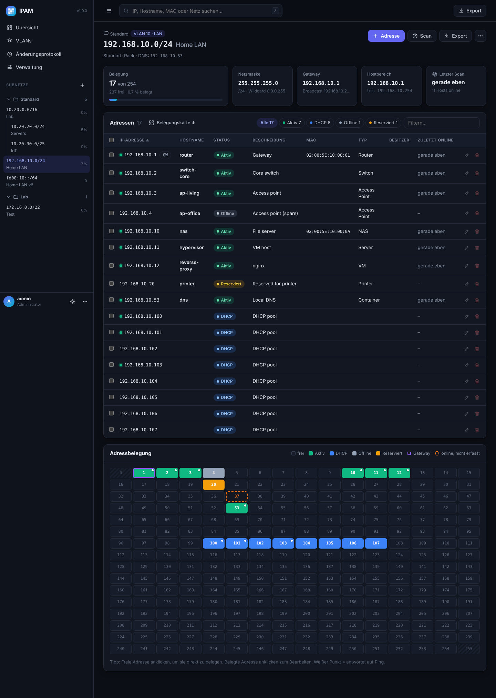

# pyIPAM

> [!WARNING]
> **pyIPAM was built with AI (Claude by Anthropic).** The code has not been independently reviewed or security-audited.
> An IPAM holds a map of your network – hosts, IP and MAC addresses, notes – which is valuable information for an attacker.
> Intended for home labs and learning – **not for production use**. Use at your own risk; no warranty of any kind.
> Review the code before you trust it, do not expose the web UI to the internet, serve it over HTTPS and keep backups outside the server.
> Provided as-is, issues and PRs may not be answered.

A lightweight, self-hosted IP address management tool inspired by phpIPAM – just the IPAM part, nothing else.
Python (Flask) + SQLite, a single backend file, no external CDNs (works fully offline).



> The web interface is currently in German. May add button to switch between DE and EN in the future

## Features

- **Local login** with its own user database – keeps working when your SSO (e.g. Authentik) is down. Roles: admin, editor, read-only
- **Sections → subnets** (IPv4 and IPv6, nested, e.g. `/16` → `/24`), VLANs
- **Host map** below each IPv4 subnet (up to /20): click a free address to quick-add it, click a used one to edit it
- **"+ Address"** button for manual entry; the next free IP is pre-filled
- **Export** to CSV (opens cleanly in Excel) and formatted **Excel (.xlsx)**, optionally including free IPs – handy as an offline backup
- **CSV import** (own export format, phpIPAM exports, custom lists)
- **Ping scan** per subnet: shows which hosts are online and which are online but not documented
- Global search (IP, hostname, MAC, description), reverse-DNS lookup, change log, bulk edit
- Daily automatic database backups, JSON backup & restore in the UI
- Dark mode, mobile-friendly

## Quick start (Docker)

No web server needed – the container serves the web UI itself.

```bash
git clone https://github.com/Flixgamer03/pyipam.git && cd pyipam
docker compose up -d
```

Open **`http://<server>:8080`** and create the admin account right away
(until an admin exists, anyone who opens the page can create one).
The first start builds the image locally, which takes a minute.

Or use the prebuilt image without cloning anything:

```bash
docker run -d --name pyipam --restart unless-stopped -p 8080:8080 \
  -v pyipam-data:/data ghcr.io/flixgamer03/pyipam:latest
```

### HTTPS

- **Own certificate:** put `cert.pem` (including the chain) and `key.pem` into `data/tls/` and restart the container.
- **Self-signed:** set `IPAM_TLS: self-signed` and `IPAM_TLS_HOSTNAME: <your hostname>` in `docker-compose.yml`.

Then open `https://<server>:8080`. To use the standard port, change the port mapping to `"443:8080"`.

### Behind your own reverse proxy (optional)

If you already run nginx, Traefik etc., change the port mapping to `"127.0.0.1:8080:8080"` and set `IPAM_TRUSTED_PROXIES: "1"`.

## Install without Docker (systemd + nginx)

Requirements: Linux with **Python 3.9+**, a reverse proxy such as **nginx**, and `ping` for the ping scan.

Run these commands as root (or with `sudo`). Paths assume `/opt/pyipam`.

**1. Install packages**

```bash
# RHEL / CentOS / Fedora
dnf install -y python3 python3-pip iputils git
# Debian / Ubuntu
apt install -y python3-venv python3-pip iputils-ping git
```

**2. Get the code and create a service user**

```bash
git clone https://github.com/Flixgamer03/pyipam.git /opt/pyipam
useradd --system --home-dir /opt/pyipam --shell /usr/sbin/nologin pyipam
```

**3. Create the Python environment**

```bash
python3 -m venv /opt/pyipam/venv
/opt/pyipam/venv/bin/pip install -r /opt/pyipam/requirements.txt
mkdir -p /opt/pyipam/data
chown -R pyipam:pyipam /opt/pyipam
chmod 750 /opt/pyipam/data
```

**4. Start the service**

```bash
cp /opt/pyipam/deploy/pyipam.service /etc/systemd/system/
systemctl daemon-reload
systemctl enable --now pyipam
```

Check: `curl http://127.0.0.1:8088/healthz` should return `{"ok":true,...}`.

**5. Set up nginx**

Copy `deploy/nginx-pyipam.conf` to `/etc/nginx/conf.d/pyipam.conf` (Debian/Ubuntu: `sites-available` + symlink),
set your hostname and certificate paths, then:

```bash
nginx -t && systemctl reload nginx
```

The file also explains how to run it over plain HTTP if you have no certificate yet.
Make sure your DNS points the hostname to the server.

**6. Create the admin account**

Open the site in your browser. On the first visit you create the admin account.
Do this right away – until an admin exists, anyone who opens the page can create one.

## Emergency access

Forgot your password or locked out? Reset it on the server:

```bash
cd /opt/pyipam
sudo -u pyipam IPAM_DATA_DIR=/opt/pyipam/data venv/bin/python app.py reset-password admin
# Docker: docker compose exec pyipam python app.py reset-password admin
```

Other commands: `create-user <name> --role admin|editor|viewer`, `list-users`, `backup` (add `--random` to generate a password).

## Backups

- **Automatic:** one SQLite copy per day in `data/backups/` (last 14 are kept; with the `docker run` example they are inside the `pyipam-data` volume).
- **Manual:** *Export* menu (Excel, CSV) or *Verwaltung → Backup* (JSON, SQLite file). JSON backups can be restored in the UI.
- These backups live on the same server – copy `data/backups/` or an Excel export somewhere else regularly.

## Configuration

Set via environment variables (in the service file or `docker-compose.yml`):

| Variable | Default | Description |
|---|---|---|
| `IPAM_DATA_DIR` | `./data` (Docker: `/data`) | Database, secret key and backups |
| `IPAM_BACKUP_KEEP` | `14` | Number of daily backups to keep (`0` = off) |
| `IPAM_SESSION_HOURS` | `12` | Login session lifetime |
| `IPAM_COOKIE_SECURE` | `auto` | `auto` sets the secure cookie flag when served via HTTPS |
| `IPAM_TRUSTED_PROXIES` | `1` (Docker: `0`) | Number of reverse proxies in front (for the real client IP) |
| `IPAM_TLS` | `auto` | Docker only: `auto` = HTTPS if `data/tls/cert.pem` + `key.pem` exist, `self-signed` = create them, `off` = HTTP |
| `IPAM_TLS_HOSTNAME` | `pyipam` | Docker only: hostname for the self-signed certificate |
| `IPAM_PORT` | `8080` | Docker only: port inside the container |

## Update

```bash
cd /opt/pyipam && sudo -u pyipam git pull
sudo /opt/pyipam/venv/bin/pip install -r requirements.txt
sudo systemctl restart pyipam
```

Docker: `git pull && docker compose up -d --build` (or `docker compose pull && docker compose up -d` for the prebuilt image).

Your data in `data/` is not touched.

## License

[MIT](LICENSE)
